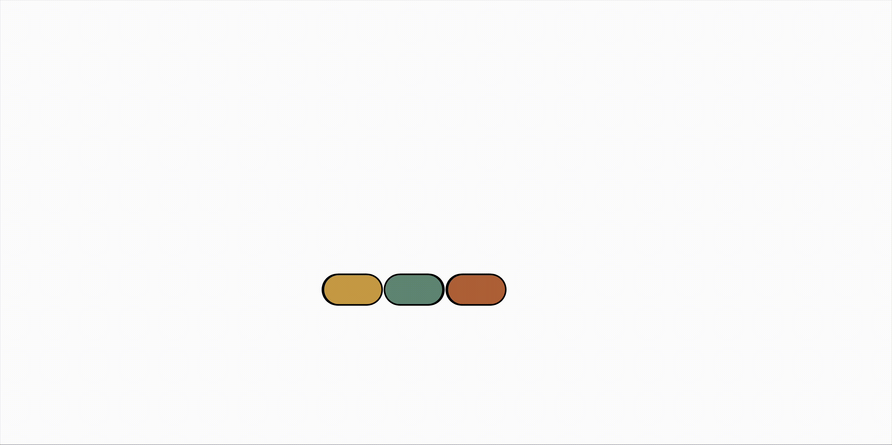

# reCYCLing



**Repeat Element Cyclical Evolutionary Simulations in Genomes**

Long-read sequencing is revealing repeat-rich genome features—centromeres, satellite arrays, and other tandem repeats—that were previously difficult to assemble and interpret. Understanding what we see in these regions often comes down to building intuition for how tandem arrays evolve under duplication, deletion, and mutation.

`reCYCLing` is a **pure simulator** of satellite repeat evolution, plus visualization. It simulates single tandem arrays or whole multi-chromosome genomes of monomers derived from a common ancestor, evolving by local duplication, long-range duplication, inter-chromosomal exchange, non-allelic gene conversion, governed deletion, and per-base mutation.

Summary statistics and inference (e.g. ABC) are intentionally **out of scope**: the package produces genomes in a simple data contract, and each project scores them with its own project-specific statistics code.

---

## Installation

```r
# install.packages("devtools")
devtools::install_github("monroe-lab/reCYCLing")
```

---

## Quick start

Two entry points:

### One tandem array — `sim_array()`

Grows an array from `init_k0` identical monomers until it reaches `max_units` (or `max_generations`):

```r
library(reCYCLing)

sim <- sim_array(
  init_l = 178,             # monomer length (bp)
  init_k0 = 10,             # initial copy number
  max_units = 10000,        # stop when array reaches this many monomers
  mu_total = 5e-5,          # per-base mutation rate
  p_local_dup = 4e-4,       # local duplication rate per monomer per generation
  p_distal_dup = 1e-5,      # long-range (within-array) duplication, per array per generation
  p_del_chunk = 1e-5        # chunk deletion rate per monomer per generation
)

plot_array_summary(sim)       # multi-panel summary
plot_repeat_fingerprint(sim)  # identical-pair dot-plot
plot_pair_distances(sim)
plot_mutation_load(sim)
```

### A multi-chromosome genome — `sim_genome()`

`K` chromosome arrays seeded from one shared ancestral monomer, aging in place for exactly `n_generations` under a genome-wide size governor:

```r
g <- sim_genome(
  K = 8,
  target_sizes = rep(5000, 8),  # monomers per chromosome
  n_generations = 3000,         # the age / divergence dial
  mu_total = 5e-5,
  p_local_dup = 3e-4,           # local duplication (turnover timescale)
  p_distal_dup = 3e-5,          # long-range duplication within a chromosome
  p_exchange = 1e-4,            # inter-chromosomal exchange (0 = none)
  hotspot_alpha = 2             # rich-get-richer local-duplication feedback (0 = uniform)
)

head(g)                # one row per monomer: chrom, num, bponly, dir
attr(g, "n_exchange")  # number of exchange events
ps <- pairs_identical(g)  # identical pairs, including cross-chromosome ones
```

### Real data in the same contract — `assemble_genome_dt()`

```r
files <- Sys.glob("fastas/MyTaxon_hap1_Chr*_monomers.fasta")
real  <- assemble_genome_dt(files)   # same columns as sim_genome() output
```

Because simulated and real genomes share one data contract (`chrom`, `num`, `bponly`, `dir`), any downstream scoring code treats them identically.

---

## What `sim_array()` returns

| Element | Description |
|---------|-------------|
| `monomers` | `data.table` of the final array (columns: `num`, `bponly`, `dir`) |
| `pairs` | All pairs of identical monomers (`pairs_identical()` output). Empty if `compute_pairs = FALSE`. |
| `L_vec` | Array length trajectory over generations |
| `H_vec` | Shannon entropy trajectory (final value only with C++ backend) |
| `N_vec` | Unique monomer count trajectory (final value only with C++ backend) |

For large arrays (>10K units), use `compute_pairs = FALSE` to skip the O(n^2) pair enumeration. Plot functions will compute pairs on the fly when needed.

---

## Simulation engine

Mechanisms applied each generation (all optional ones default **off**):

| Process | Rate parameter | Description |
|---------|----------------|-------------|
| **Local duplication** | `p_local_dup` | Tandem copy-paste of a chunk in place |
| **Long-range (distal) duplication** | `p_distal_dup` | Copy-paste to a distant position on the same array/chromosome (optional inversion) |
| **Inter-chromosomal exchange** | `p_exchange` (genome only) | Duplicative transfer of a block to a different chromosome |
| **Gene conversion** | `p_conversion` (+ `p_conv_interchrom`) | A donor monomer's sequence overwrites a recipient's — homogenizes without adding units |
| **Hotspot feedback** | `hotspot_alpha` (genome only) | Local-duplication probability ∝ identical-family size^α, mean-preserving |
| **Deletion** | `p_del_chunk`, `p_terminal_del` (array); size governor (genome) | Chunk removal / genome-wide size balance |
| **Per-base mutation** | `mu_total` | Substitutions (default), optional indels (`p_ins`, `p_del_bp`, R backend) |

Two backends:

- **C++ backend** (default): ~100x faster. Deferred mutations—mutations accumulate as a counter per monomer and materialize on duplication (Jukes-Cantor). Substitutions only. `sim_genome()` is C++-only.
- **R backend**: Slower but supports indels. Selected automatically when indels are requested.

Chunk-size distributions are specified as lists:

```r
local_dist    <- list(type = "gamma", shape = 2, scale = 15)
distal_dist   <- list(type = "gamma", shape = 2, scale = 500)
exchange_dist <- list(type = "gamma", shape = 1, scale = 500)
del_dist      <- list(type = "geom",  prob = 0.1)
```

Supported types: `"fixed"`, `"poisson"`, `"normal"`, `"geom"`, `"unif"`, `"gamma"`.

The full model specification — data contract, per-generation update order, every mechanism with its rate, chunk-size distribution and defaults, and the backend differences — is in [MODEL.md](MODEL.md).

---

## Diagnostic plots

| Function | What it shows |
|----------|---------------|
| `plot_repeat_fingerprint()` | Dot-plot of identical pairs (self-similarity / duplication structure) |
| `plot_pair_distances()` | Distance distribution of identical pairs (local vs long-range signature) |
| `plot_copy_numbers()` | Copies per unique monomer sequence |
| `plot_mutation_load()` | Mismatches per monomer relative to consensus |
| `plot_consensus_support()` | Per-position consensus support across the array |
| `plot_array_summary()` | Combined multi-panel overview |
| `plot_repeat_barcode()` | Linear barcode of identical monomers in a zoom window |
| `plot_circular_seqcounts()` | Circular per-position base-composition plot |

---

## Vignettes

```r
vignette("reCYCLing-intro")                       # worked walkthrough of sim_array + plots
vignette("equilibrium-dynamics")                  # steady-state turnover and the mutation clock
vignette("mechanisms-conversion-and-hotspots")    # gene conversion + hotspot feedback
```

---

## History

Versions ≤ 1.0.3 bundled an ABC summary-statistics catalog (`repeat_summary_stats`, `repeat_genome_stats`, and predictors). As of 1.9.0 those live in project-specific analysis code, not in the package. The 1.9.x series is the pure-simulator development line; it will be tagged **2.0.0** when the accompanying paper is submitted.

## Notes

This is a research codebase developed mainly for internal use in the Monroe Lab; it is evolving and documentation may change. Please feel free to try — contribute to Issues if you would like.
